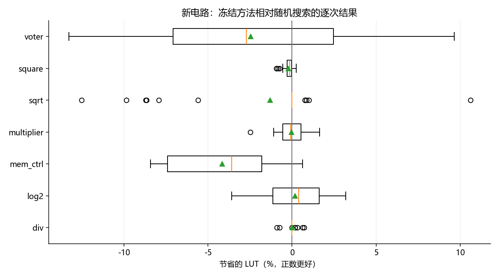

# 面向 FPGA 6-LUT 映射的逻辑综合序列搜索

[](https://github.com/ting2698009013/eda-coursework/actions/workflows/tests.yml)

一个 EDA 课程研究项目：调用 ABC 执行不同的逻辑优化序列，在**功能等价、LUT 层数不超过 resyn2 基准**的条件下，寻找使用更少 LUT 的组合电路实现。

项目关注搜索策略、预算控制和实验评价。ABC 负责底层逻辑优化、映射和等价检查；Python 实现搜索、实验调度、统计和报告。这里没有开发板下载流程，也没有真实 FPGA 的布局布线、频率或功耗测量。

## 已实现的内容

- 随机搜索、贪心、AIG 束搜索、LUT 束搜索、保留随机探索分支的束搜索和整序列局部搜索。
- 调用次数与墙钟时间预算；超时后保留已验证的基准回退结果。
- 分别验证优化后的 AIG 与映射后的 BLIF，并保存原始工具日志和可重放脚本。
- 固定输入与源码校验和、随机运行顺序、按相邻时段块配对、严格断点恢复。
- 电路等权统计、配对 bootstrap 区间、失败路径及真实 ABC 集成测试。

## 先看结果

公开副本保留了扩展实验的[报告](reports/extension/REPORT.md)、[统计摘要](reports/extension/findings.json)和六个阶段的逐次指标 CSV。**整序列局部搜索没有在新电路上超过随机搜索**：在通过预检查的 7 个电路、每方法每电路 30 次、10 秒搜索预算下，平均多用约 1.08% LUT，95% 区间为多用 0.67%–1.50%。开发集上约 0.69% 的改善没有延续到新电路。

这是一次保留负向结果的课程实验，不能据此声称提出了优于现有方法的算法。`hyp` 因固定参考的 BLIF 等价检查超时未纳入，报告同时列出全部 8 个候选电路及原因。



完整运行网表、历史源码快照与数万份日志未放入 Git。公开 CSV 可用于复算报告主比较，但不是完整的逐文件审计包。原始实验与复现范围见 [公开内容说明](docs/PUBLICATION.md)。

## 快速开始

推荐 **Ubuntu 24.04 x86-64**，Windows 可使用安装了该发行版的 WSL。Python 3.10 或更新版本即可；搜索与测试核心仅依赖标准库。

在仓库根目录运行：

```bash
# 下载固定版本工具到仓库内 .tools/，不全局安装。
# 需要网络、dpkg-deb，约 10 MB 软件包；已有输入会检查校验和。
python3 scripts/bootstrap.py

# 检查 ABC 和 12 个初始输入；校验全部 20 个基准及公开统计摘要。
python3 -m lutsearch doctor
python3 scripts/check_publication.py

# 含真实 ABC 调用、双重等价验证和故意构造的不等价反例。
python3 -m unittest discover -s tests -v

# 一个小型搜索示例；输出目录必须不存在。
python3 -m lutsearch search --input benchmarks/int2float.aig \
  --out results/demo --method lut_beam --calls 80
```

Windows PowerShell 用户可先执行 `python scripts/bootstrap.py`，再用 `./run.ps1 doctor`、`./run.ps1 test`、`./run.ps1 demo`。此入口固定使用名为 `Ubuntu` 的 WSL 发行版；其他名称请直接在对应 Linux 终端执行上面的命令。

只有 Python、没有 ABC 时，单元测试仍能运行，真实工具集成测试会标记为跳过；这不等于通过了完整的端到端验证。CI 使用 Ubuntu 24.04，安装固定工具后运行完整测试，并检查公开基准与统计结果。

已有 ABC 时可设置 `ABC_BIN` 为可执行文件的绝对路径；Verilog 转换另需 `YOSYS_BIN`。工具版本变化后应新建实验，不能把不同版本的指标混为一组。

## 自己的电路与批量实验

```bash
# 单文件、组合逻辑 Verilog 示例；时序电路与未解析模块会报错。
python3 -m lutsearch prepare --verilog examples/alu.v --top alu \
  --out results/alu/input.aig
python3 -m lutsearch search --input results/alu/input.aig \
  --out results/alu-search --method sequence_local --restart-after 20 \
  --seconds 10 --calls 10000

# 工程小试跑，随后可以审计或生成报告。
python3 -m lutsearch run --config configs/smoke.json --out results/smoke
python3 scripts/audit_results.py results/smoke --out results/smoke/audit.json
python3 scripts/replay_results.py results/smoke --all
```

生成图表需额外安装报告依赖：`python3 -m pip install -e ".[report]"`，然后运行 `python3 -m lutsearch report --run results/smoke`。完整扩展实验可能运行数小时；搜索预算不包含固定参考准备和最终等价验证。不要在不了解资源开销时直接启动大规模配置。

## 目录

```text
lutsearch/       ABC 接口、搜索、实验调度、统计与报告
scripts/         下载、验证、审计、重放和分析工具
tests/           标准库 unittest 单元与真实工具集成测试
configs/         小试跑与各实验阶段的配置
benchmarks/      固定提交的 EPFL 电路及原 MIT 许可证
examples/alu.v   组合 ALU 示例
reports/         扩展报告、图片和逐次指标 CSV（非完整日志包）
docs/            算法、发布范围、第三方来源与 AI 辅助说明
```

## 研究边界与来源

研究模型固定为组合电路和通用 6-LUT 映射；LUT 层数是结构指标，不能直接换算成器件上的最高频率。当前实现每次从原始输入重放完整操作序列，计时也包括这一开销。限时搜索受机器负载影响，重新搜索不保证找回逐次相同的序列。

算法细节见 [ALGORITHM](docs/ALGORITHM.md)。第三方 ABC、Yosys 与 EPFL 基准的来源见 [THIRD_PARTY](docs/THIRD_PARTY.md)，EPFL 原许可保留在 [EPFL_LICENSE](benchmarks/EPFL_LICENSE)。AI 在代码、实验和文档中的辅助范围单独记录在 [AI_USAGE](docs/AI_USAGE.md)。

课程题目 PDF、课堂材料、工具二进制、个人演示文稿和本机路径未包含在本仓库。仓库暂未为自有代码授予统一开源许可证；第三方文件继续遵循其附带许可。
