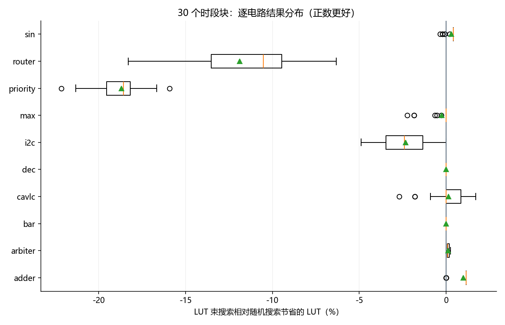
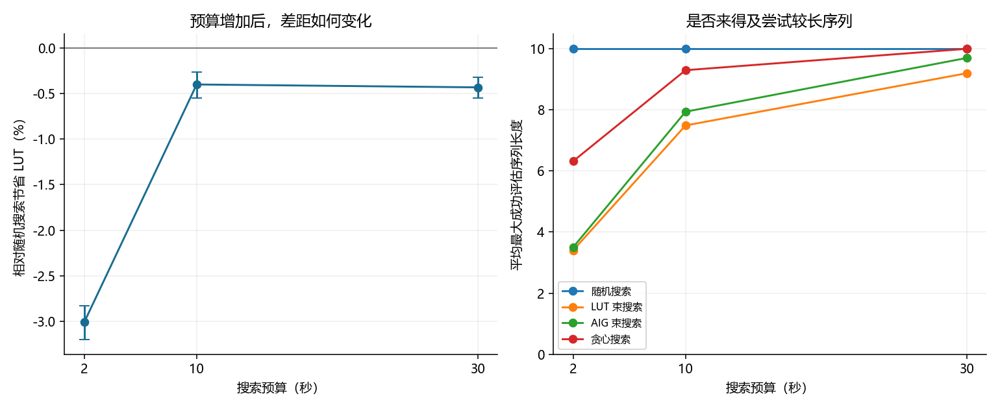
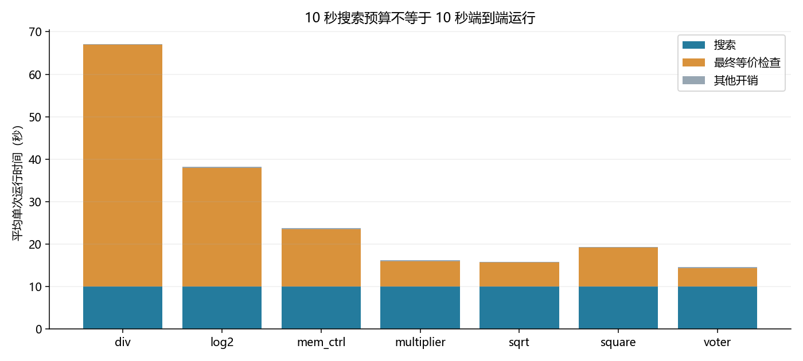

# 扩展实验报告

本报告汇总已完成处理的阶段，验证、审计或重放未通过时明确标出并暂停主比较。各表注明比较对象；LUT 降幅为正表示使用更少的 LUT，为负表示更多。

## 主要发现

### E1：原差距在当前条件下稳定

10 个旧电路、每个主方法 30 次重复，2 秒预算下普通 LUT 束搜索相对随机搜索的 LUT 降幅为 -2.97%，95% 区间 [-3.10%, -2.84%]。负数表示更多 LUT；这描述当前电路集合中的重复波动，不是排除一切偶然性或证明普遍排名。

### E2：增加预算改变了差距，但不能解决所有案例

10 秒与 30 秒下，普通 LUT 束搜索相对随机搜索分别为 -0.40%、-0.43%。priority 基本追平；router 在完成十层后仍落后；sin 则仍受搜索深度限制。这些是探索性的预算对照。

### E3：长序列和评分的效果都依赖电路

固定 10 秒下，长度 10 相对长度 3 在 priority、i2c 分别节省约 15.65%、3.76%，但 sin 多用约 0.13%。全部映射的评分对照中，AIG 评分在 i2c 略好，LUT 评分在 sin 略好，priority 的 LUT 数相同。没有一种评分全面获胜；三个人为选取的案例也不能解释所有电路。

### E4：冻结一项有限改进

整序列局部搜索选择停滞 20 次后重启，开发集相对随机搜索节省约 0.69% LUT。三个参数结果全部保留。这是选择配置的依据，不是新电路上的性能证明。

### E5：资源范围

8 个新电路全部做过固定参考预检查，7 个符合预定资源和验证条件。未纳入：hyp：直接映射 BLIF 的 CEC 超过 120 秒；AIG 等价检查通过。这会偏向本机能够处理和验证的电路，不按搜索收益筛选。

### E5：冻结方法的最终结果

新方法比随机搜索平均多用 1.08% LUT，95% 区间为多用 0.67%–1.50%。在这组可运行电路上，新方法比随机搜索更差，改进没有泛化成功。结果只对应当前工具、10 秒预算及纳入的电路。

## 完成情况

| 阶段 | 完成 | 计划 | 结果有效 | 审计 | 重放 | 运行分钟 | 含审计重放分钟 |
| --- | --- | --- | --- | --- | --- | --- | --- |
| e1_stability | 1000 | 1000 | True | True | True | 43.6 | 53.7 |
| e2_budget | 600 | 600 | True | True | True | 146.6 | 153.5 |
| e3_length | 90 | 90 | True | True | True | 16.3 | 18.1 |
| e3_score | 6 | 6 | True | True | True | 3.8 | 3.9 |
| e4_development | 250 | 250 | True | True | True | 43.9 | 46.8 |
| e5_holdout | 630 | 630 | True | True | True | 299.1 | 507.3 |

## E1：2 秒下的稳定性

普通 LUT 束搜索相对随机搜索：**-2.97% [-3.10%, -2.84%]**。区间固定当前 10 个诊断电路，只反映种子与计时重复波动。

对电路组成重新抽样的敏感性范围为 [-7.27%, +0.11%]。它用于观察结论是否依赖电路构成；这些电路并非所有 FPGA 电路的随机样本，不能把该范围当作普遍推广保证。

| 电路 | 相对随机搜索 | 胜 | 平 | 负 |
| --- | --- | --- | --- | --- |
| adder | +1.01% | 26 | 4 | 0 |
| arbiter | +0.12% | 24 | 6 | 0 |
| bar | +0.00% | 0 | 30 | 0 |
| cavlc | +0.14% | 14 | 10 | 6 |
| dec | +0.00% | 0 | 30 | 0 |
| i2c | -2.32% | 0 | 1 | 29 |
| max | -0.24% | 0 | 24 | 6 |
| priority | -18.68% | 0 | 0 | 30 |
| router | -11.84% | 0 | 0 | 30 |
| sin | +0.31% | 25 | 0 | 5 |

### 其他方法的描述性结果

下表相对 resyn2 汇总，各电路等权。重复数不同的方法只作描述性对照，不从中重新挑选主比较。

| 方法 | 每电路重复次数 | 相对 resyn2 的 LUT 降幅 |
| --- | --- | --- |
| AIG 束搜索 | 5 | 0.48% |
| 贪心搜索 | 5 | 2.24% |
| LUT 束搜索 | 30 | 0.70% |
| 探索分支束搜索 | 30 | 0.70% |
| 随机搜索 | 30 | 3.56% |

图中箱体覆盖中间一半结果，橙线为中位数，绿色三角为平均值；圆点为箱线图规则标出的离群点，仍计入统计。

## E2：计算预算

每个时间点主方法各 10 次；2 秒点取 E1 预定前 10 个块。不同预算分别运行，属于探索性比较。

| 预算 | LUT 束搜索相对随机搜索及 95% 区间 |
| --- | --- |
| 2 秒 | -3.01% [-3.20%, -2.83%] |
| 10 秒 | -0.40% [-0.55%, -0.26%] |
| 30 秒 | -0.43% [-0.55%, -0.32%] |

| 秒 | 方法 | 平均已评估序列长度 | 完成规定搜索流程数 | 运行数 |
| --- | --- | --- | --- | --- |
| 2 | 随机搜索 | 10.00 | 0 | 100 |
| 10 | 随机搜索 | 10.00 | 0 | 100 |
| 30 | 随机搜索 | 10.00 | 0 | 100 |
| 2 | LUT 束搜索 | 3.40 | 9 | 100 |
| 10 | LUT 束搜索 | 7.49 | 28 | 100 |
| 30 | LUT 束搜索 | 9.20 | 80 | 100 |
| 2 | AIG 束搜索 | 3.50 | 5 | 50 |
| 10 | AIG 束搜索 | 7.94 | 15 | 50 |
| 30 | AIG 束搜索 | 9.70 | 40 | 50 |
| 2 | 贪心搜索 | 6.32 | 5 | 50 |
| 10 | 贪心搜索 | 9.30 | 40 | 50 |
| 30 | 贪心搜索 | 10.00 | 50 | 50 |

这里的长度是优化操作数，不是电路的 LUT 层数。AIG 方法的已评估长度包含只完成 AIG 评分的候选。完成搜索流程指完成当前束宽和长度配置，不能理解为穷尽所有可能序列。

### 实际计算开销

| 预算秒 | 方法 | 平均搜索秒 | 平均成功调用 | 平均映射次数 | 平均成功调用/秒 |
| --- | --- | --- | --- | --- | --- |
| 2 | 随机搜索 | 2.00 | 18.3 | 18.3 | 9.1 |
| 2 | LUT 束搜索 | 2.00 | 30.7 | 30.7 | 15.4 |
| 2 | AIG 束搜索 | 1.98 | 42.1 | 7.7 | 21.4 |
| 2 | 贪心搜索 | 2.00 | 29.9 | 29.9 | 15.0 |
| 10 | 随机搜索 | 10.00 | 93.0 | 93.0 | 9.3 |
| 10 | LUT 束搜索 | 9.11 | 114.3 | 114.3 | 13.6 |
| 10 | AIG 束搜索 | 9.01 | 150.1 | 26.4 | 18.1 |
| 10 | 贪心搜索 | 4.74 | 46.0 | 46.0 | 13.7 |
| 30 | 随机搜索 | 30.00 | 280.2 | 280.2 | 9.3 |
| 30 | LUT 束搜索 | 16.28 | 153.3 | 153.3 | 13.0 |
| 30 | AIG 束搜索 | 15.65 | 197.1 | 34.9 | 17.5 |
| 30 | 贪心搜索 | 7.14 | 50.0 | 50.0 | 13.7 |

成功调用包含 AIG 评分或映射，不能把不同类型的调用当作相同工作量；比较最终质量时仍采用相同墙钟预算。固定参考、导出和最终等价检查在搜索预算之外，原始记录分别保存其耗时。

## E3：序列长度对照（探索性）

| 电路 | 方法 | 次数 | LUT 中位数 | 范围 | 平均已评估序列长度 |
| --- | --- | --- | --- | --- | --- |
| i2c | 随机搜索，长度 10 | 10 | 310.5 | 305–314 | 10.00 |
| i2c | 随机搜索，长度 3 | 10 | 322.0 | 322–322 | 3.00 |
| i2c | 随机搜索，长度 5 | 10 | 321.5 | 319–322 | 5.00 |
| priority | 随机搜索，长度 10 | 10 | 151.0 | 148–154 | 10.00 |
| priority | 随机搜索，长度 3 | 10 | 179.0 | 179–179 | 3.00 |
| priority | 随机搜索，长度 5 | 10 | 162.0 | 160–163 | 5.00 |
| sin | 随机搜索，长度 10 | 10 | 1448.5 | 1443–1452 | 10.00 |
| sin | 随机搜索，长度 3 | 10 | 1445.0 | 1442–1451 | 3.00 |
| sin | 随机搜索，长度 5 | 10 | 1442.0 | 1436–1451 | 5.00 |

## E3：评分对照（探索性）

| 电路 | 方法 | 次数 | LUT 中位数 | 范围 | 平均已评估序列长度 |
| --- | --- | --- | --- | --- | --- |
| i2c | AIG 评分（全部映射） | 1 | 306 | 306–306 | 10.00 |
| i2c | LUT 束搜索 | 1 | 307 | 307–307 | 10.00 |
| priority | AIG 评分（全部映射） | 1 | 150 | 150–150 | 10.00 |
| priority | LUT 束搜索 | 1 | 150 | 150–150 | 10.00 |
| sin | AIG 评分（全部映射） | 1 | 1441 | 1441–1441 | 10.00 |
| sin | LUT 束搜索 | 1 | 1439 | 1439–1439 | 10.00 |

## E4：开发结果（探索性）

| 电路 | 方法 | 次数 | LUT 中位数 | 范围 | 平均已评估序列长度 |
| --- | --- | --- | --- | --- | --- |
| adder | 局部搜索，停滞 10 次重启 | 5 | 257 | 254–257 | 10.00 |
| adder | 局部搜索，停滞 20 次重启 | 5 | 257 | 254–257 | 10.00 |
| adder | 局部搜索，停滞 5 次重启 | 5 | 257 | 254–257 | 10.00 |
| adder | LUT 束搜索 | 5 | 254 | 254–254 | 10.00 |
| adder | 随机搜索 | 5 | 257 | 254–257 | 10.00 |
| arbiter | 局部搜索，停滞 10 次重启 | 5 | 2722 | 2715–2722 | 10.00 |
| arbiter | 局部搜索，停滞 20 次重启 | 5 | 2722 | 2715–2722 | 10.00 |
| arbiter | 局部搜索，停滞 5 次重启 | 5 | 2718 | 2717–2722 | 10.00 |
| arbiter | LUT 束搜索 | 5 | 2715 | 2715–2715 | 3.00 |
| arbiter | 随机搜索 | 5 | 2715 | 2715–2718 | 10.00 |
| bar | 局部搜索，停滞 10 次重启 | 5 | 512 | 512–512 | 10.00 |
| bar | 局部搜索，停滞 20 次重启 | 5 | 512 | 512–512 | 10.00 |
| bar | 局部搜索，停滞 5 次重启 | 5 | 512 | 512–512 | 10.00 |
| bar | LUT 束搜索 | 5 | 512 | 512–512 | 8.00 |
| bar | 随机搜索 | 5 | 512 | 512–512 | 10.00 |
| cavlc | 局部搜索，停滞 10 次重启 | 5 | 113 | 112–114 | 10.00 |
| cavlc | 局部搜索，停滞 20 次重启 | 5 | 112 | 110–112 | 10.00 |
| cavlc | 局部搜索，停滞 5 次重启 | 5 | 112 | 110–114 | 10.00 |
| cavlc | LUT 束搜索 | 5 | 111 | 111–111 | 9.00 |
| cavlc | 随机搜索 | 5 | 113 | 112–114 | 10.00 |
| dec | 局部搜索，停滞 10 次重启 | 5 | 287 | 287–287 | 10.00 |
| dec | 局部搜索，停滞 20 次重启 | 5 | 287 | 287–287 | 10.00 |
| dec | 局部搜索，停滞 5 次重启 | 5 | 287 | 287–287 | 10.00 |
| dec | LUT 束搜索 | 5 | 287 | 287–287 | 10.00 |
| dec | 随机搜索 | 5 | 287 | 287–287 | 10.00 |
| i2c | 局部搜索，停滞 10 次重启 | 5 | 308 | 306–313 | 10.00 |
| i2c | 局部搜索，停滞 20 次重启 | 5 | 305 | 304–309 | 10.00 |
| i2c | 局部搜索，停滞 5 次重启 | 5 | 310 | 301–312 | 10.00 |
| i2c | LUT 束搜索 | 5 | 312 | 312–312 | 7.00 |
| i2c | 随机搜索 | 5 | 311 | 306–312 | 10.00 |
| max | 局部搜索，停滞 10 次重启 | 5 | 771 | 764–777 | 10.00 |
| max | 局部搜索，停滞 20 次重启 | 5 | 772 | 761–777 | 10.00 |
| max | 局部搜索，停滞 5 次重启 | 5 | 774 | 760–777 | 10.00 |
| max | LUT 束搜索 | 5 | 777 | 777–777 | 6.00 |
| max | 随机搜索 | 5 | 777 | 770–777 | 10.00 |
| priority | 局部搜索，停滞 10 次重启 | 5 | 149 | 147–150 | 10.00 |
| priority | 局部搜索，停滞 20 次重启 | 5 | 149 | 148–151 | 10.00 |
| priority | 局部搜索，停滞 5 次重启 | 5 | 150 | 148–151 | 10.00 |
| priority | LUT 束搜索 | 5 | 151 | 151–151 | 9.00 |
| priority | 随机搜索 | 5 | 150 | 148–151 | 10.00 |
| router | 局部搜索，停滞 10 次重启 | 5 | 72 | 70–75 | 10.00 |
| router | 局部搜索，停滞 20 次重启 | 5 | 71 | 69–72 | 10.00 |
| router | 局部搜索，停滞 5 次重启 | 5 | 73 | 70–74 | 10.00 |
| router | LUT 束搜索 | 5 | 76 | 76–76 | 10.00 |
| router | 随机搜索 | 5 | 73 | 71–75 | 10.00 |
| sin | 局部搜索，停滞 10 次重启 | 5 | 1452 | 1447–1452 | 10.00 |
| sin | 局部搜索，停滞 20 次重启 | 5 | 1452 | 1450–1452 | 10.00 |
| sin | 局部搜索，停滞 5 次重启 | 5 | 1452 | 1440–1452 | 10.00 |
| sin | LUT 束搜索 | 5 | 1446 | 1446–1446 | 3.00 |
| sin | 随机搜索 | 5 | 1449 | 1439–1452 | 10.00 |

| 停滞阈值 | 相对随机搜索的 LUT 降幅 |
| --- | --- |
| 5 | +0.29% |
| 10 | +0.23% |
| 20 | +0.69% |

按运行前规则选中停滞阈值 **20**：距最高降幅不超过 0.10 个百分点时，选较大的阈值以减少重启。开发结果用于选择配置，最终性能证据来自 E5。

新方法先在预算内重新评估 resyn2，之后单次替换一个操作，接受目标不变差的修改，停滞后随机重启。所得效果包括初始化、反馈和重启共同作用。

## E3 的机制证据

| 案例 | 长度 10 相对长度 3 的 LUT 降幅 |
| --- | --- |
| i2c | +3.76% |
| priority | +15.65% |
| sin | -0.13% |

这三个案例按既有现象挑选。长度变化同时影响单次开销、可达结构和有限序列空间大小，不把这项对照解释成唯一原因的证明。

| 案例 | 随机序列长度 | 平均成功映射次数 | 映射候选可行比例 | 平均成功调用秒 | 穷尽该长度序列的运行数 |
| --- | --- | --- | --- | --- | --- |
| i2c | 3 | 125.0 | 100.0% | 0.066 | 10/10 |
| i2c | 5 | 126.3 | 100.0% | 0.078 | 0/10 |
| i2c | 10 | 97.4 | 100.0% | 0.101 | 0/10 |
| priority | 3 | 125.0 | 11.2% | 0.062 | 10/10 |
| priority | 5 | 136.0 | 36.1% | 0.072 | 0/10 |
| priority | 10 | 112.0 | 80.1% | 0.088 | 0/10 |
| sin | 3 | 34.7 | 49.7% | 0.283 | 0/10 |
| sin | 5 | 26.6 | 69.8% | 0.369 | 0/10 |
| sin | 10 | 16.7 | 95.2% | 0.582 | 0/10 |

所有长度设置都保留同一个 resyn2 回退结果；resyn2 本身有 10 个操作。因此，尝试完全部三步序列，并不意味着最终输出一定来自三步序列，也不能把含回退的最终 LUT 数直接称为三步空间的最优值。

| 案例 | 评分 | 最终 LUT | 达到长度 | 停止原因 | 剪掉全部层内最优可行候选的层数 |
| --- | --- | --- | --- | --- | --- |
| i2c | AIG 评分（全部映射） | 306 | 10 | 完成规定搜索流程 | 5 |
| i2c | LUT 束搜索 | 307 | 10 | 完成规定搜索流程 | 0 |
| priority | AIG 评分（全部映射） | 150 | 10 | 完成规定搜索流程 | 3 |
| priority | LUT 束搜索 | 150 | 10 | 完成规定搜索流程 | 0 |
| sin | AIG 评分（全部映射） | 1441 | 10 | 完成规定搜索流程 | 10 |
| sin | LUT 束搜索 | 1439 | 10 | 完成规定搜索流程 | 0 |

两种评分对照都映射全部候选，并把已经发现的可行最优结果保留为全局冠军。剪枝影响后续搜索路径，不会丢掉已经发现的最优输出；因此不能仅由某层剪枝推断最终结果必然变差。

## 新电路可运行性

8 个候选电路全部披露。准入按输入支持、固定脚本验证和预定资源限制决定，不按优化收益筛选。内存限制为 8 GiB 虚拟地址空间。

| 电路 | 可纳入 | 秒 | 子进程峰值 RSS / MiB | 原因 |
| --- | --- | --- | --- | --- |
| div | True | 121.64 | 99.2 | 通过 |
| hyp | False | 124.53 | 364.3 | 直接映射 BLIF 的 CEC 超过 120 秒；AIG 等价检查通过 |
| log2 | True | 82.21 | 78.1 | 通过 |
| multiplier | True | 23.73 | 64.3 | 通过 |
| sqrt | True | 48.54 | 57.9 | 通过 |
| square | True | 29.89 | 51.4 | 通过 |
| mem_ctrl | True | 41.79 | 83.7 | 通过 |
| voter | True | 14.88 | 41.7 | 通过 |

## E5：搜索以外的验证成本

下表汇总三种方法生成摘要的全部 630 次运行，其中初次验证未通过 0 次。公共参考准备和后续独立重放不在单次运行耗时中；没有摘要的程序异常条目在完成记录中另列。

| 电路 | 次数 | 平均搜索秒 | 平均最终 CEC 秒 | 平均单次总秒 |
| --- | --- | --- | --- | --- |
| div | 90 | 10.00 | 56.93 | 67.16 |
| log2 | 90 | 10.00 | 27.96 | 38.17 |
| mem_ctrl | 90 | 10.00 | 13.55 | 23.77 |
| multiplier | 90 | 10.00 | 5.99 | 16.19 |
| sqrt | 90 | 10.00 | 5.68 | 15.89 |
| square | 90 | 10.00 | 9.21 | 19.40 |
| voter | 90 | 10.00 | 4.42 | 14.61 |

## E5：新电路最终评价

冻结方法“整序列局部搜索”相对随机搜索：**-1.08% [-1.50%, -0.67%]**。

这是预定 10 秒预算下、通过资源预检查的新电路上的结果，不能扩展为所有 FPGA 电路或真实频率、功耗的结论。

对电路组成重新抽样的敏感性范围为 [-2.28%, -0.12%]。它用于观察结论是否依赖电路构成；这些电路并非所有 FPGA 电路的随机样本，不能把该范围当作普遍推广保证。

| 电路 | 新方法相对随机搜索的 LUT 降幅 | 胜 | 平 | 负 |
| --- | --- | --- | --- | --- |
| div | +0.01% | 5 | 22 | 3 |
| log2 | +0.20% | 17 | 0 | 13 |
| mem_ctrl | -4.12% | 3 | 0 | 27 |
| multiplier | -0.03% | 14 | 0 | 16 |
| sqrt | -1.22% | 5 | 19 | 6 |
| square | -0.22% | 6 | 0 | 24 |
| voter | -2.28% | 12 | 0 | 18 |

次要对照点估计：原 LUT 束搜索相对随机搜索节省 -0.40%；新方法相对原 LUT 束搜索节省 -0.68%。这些对照用于解释新方法的增量价值，不改变预先指定的主比较。

| 电路 | 方法 | 次数 | LUT 中位数 | 范围 | 回退率 |
| --- | --- | --- | --- | --- | --- |
| div | LUT 束搜索 | 30 | 9919.0 | 9919–9919 | 100% |
| div | 随机搜索 | 30 | 9919.0 | 9830–9919 | 87% |
| div | 整序列局部搜索 | 30 | 9919.0 | 9842–9919 | 83% |
| log2 | LUT 束搜索 | 30 | 8063.0 | 8001–8063 | 53% |
| log2 | 随机搜索 | 30 | 8029.5 | 7768–8063 | 43% |
| log2 | 整序列局部搜索 | 30 | 7992.0 | 7805–8063 | 7% |
| mem_ctrl | LUT 束搜索 | 30 | 11766.0 | 11766–11766 | 100% |
| mem_ctrl | 随机搜索 | 30 | 11158.5 | 10733–11766 | 7% |
| mem_ctrl | 整序列局部搜索 | 30 | 11718.0 | 11323–11766 | 23% |
| multiplier | LUT 束搜索 | 30 | 5881.0 | 5881–5881 | 0% |
| multiplier | 随机搜索 | 30 | 5892.0 | 5773–5916 | 20% |
| multiplier | 整序列局部搜索 | 30 | 5892.0 | 5819–5916 | 33% |
| sqrt | LUT 束搜索 | 30 | 4409.0 | 4409–4409 | 100% |
| sqrt | 随机搜索 | 30 | 4409.0 | 3919–4409 | 77% |
| sqrt | 整序列局部搜索 | 30 | 4409.0 | 3941–4409 | 80% |
| square | LUT 束搜索 | 30 | 3909.0 | 3909–3909 | 0% |
| square | 随机搜索 | 30 | 3916.0 | 3909–3931 | 0% |
| square | 整序列局部搜索 | 30 | 3922.0 | 3918–3950 | 3% |
| voter | LUT 束搜索 | 30 | 1530.0 | 1530–1530 | 0% |
| voter | 随机搜索 | 30 | 1600.0 | 1480–1702 | 0% |
| voter | 整序列局部搜索 | 30 | 1638.5 | 1535–1748 | 0% |

### 固定脚本参考

resyn2×2 含 20 个操作，是搜索空间之外的强参考；表中同时标明它是否满足当前深度约束。相对随机搜索有收益，也不自动意味着超过这些固定脚本。

| 电路 | 固定脚本 | LUT | LUT 层数 | 满足深度约束 |
| --- | --- | --- | --- | --- |
| div | unoptimized | 22031 | 864 | False |
| div | resyn2 | 9919 | 858 | True |
| div | resyn2x2 | 9846 | 858 | True |
| log2 | unoptimized | 8008 | 77 | False |
| log2 | resyn2 | 8063 | 71 | True |
| log2 | resyn2x2 | 8030 | 71 | True |
| mem_ctrl | unoptimized | 12096 | 25 | True |
| mem_ctrl | resyn2 | 11766 | 25 | True |
| mem_ctrl | resyn2x2 | 11727 | 24 | True |
| multiplier | unoptimized | 5913 | 53 | True |
| multiplier | resyn2 | 5916 | 53 | True |
| multiplier | resyn2x2 | 5924 | 53 | True |
| sqrt | unoptimized | 5720 | 1033 | False |
| sqrt | resyn2 | 4409 | 1005 | True |
| sqrt | resyn2x2 | 4415 | 1005 | True |
| square | unoptimized | 3985 | 50 | True |
| square | resyn2 | 3950 | 50 | True |
| square | resyn2x2 | 3948 | 50 | True |
| voter | unoptimized | 2818 | 17 | False |
| voter | resyn2 | 1785 | 13 | True |
| voter | resyn2x2 | 1807 | 13 | True |

逐电路取三个固定脚本中满足深度约束且 LUT 最少的一项，冻结方法相对这一参考的等权 LUT 降幅为 **+1.57%**（描述性点估计）。此比较揭示搜索是否超越简单固定脚本；固定参考的准备开销单独记录，没有纳入 10 秒搜索预算。

| 电路 | 最佳可行固定脚本 | 参考 LUT | 冻结方法相对降幅 | 严格胜过参考次数 | 运行数 |
| --- | --- | --- | --- | --- | --- |
| div | resyn2x2 | 9846 | -0.67% | 1 | 30 |
| log2 | resyn2x2 | 8030 | +0.87% | 24 | 30 |
| mem_ctrl | resyn2x2 | 11727 | +0.65% | 17 | 30 |
| multiplier | unoptimized | 5913 | +0.41% | 20 | 30 |
| sqrt | resyn2 | 4409 | +0.52% | 6 | 30 |
| square | resyn2x2 | 3948 | +0.55% | 28 | 30 |
| voter | resyn2 | 1785 | +8.38% | 30 | 30 |

| 方法 | 相对最佳可行固定脚本的 LUT 降幅 |
| --- | --- |
| 随机搜索 | +2.63% |
| LUT 束搜索 | +2.24% |
| 整序列局部搜索 | +1.57% |

上表均为同一组电路等权的描述性点估计。超过固定脚本说明尝试不同序列有收益；只有再超过同预算随机搜索，才能支持新策略带来了额外价值。

箱体覆盖中间一半结果，橙线为中位数，绿色三角为平均值；全部点均保留在统计中。

## 如何理解证据

- 主指标先在每电路内平均 log(LUT 比值)，再对电路等权平均；区间对实际时段块联合重采样 10,000 次。
- 原 10 个电路已经用于诊断，E4 开发结论与新电路评价分开。预算和机制对照属于探索性分析。
- 1% 相对 LUT 改善是本项目预设工程目标，不是通用显著性门槛。
- 计时受实际机器状态影响；重复和随机运行顺序用于降低影响，无法完全控制后台负载。
- 本原型从原始 AIG 重放完整操作序列来评估每个候选，便于准确复现，也会产生重复前缀的开销；没有测试增量执行版束搜索，结论限于当前实现与配置。
- CEC 是功能正确性检查，不是统计稳定性证据。固定基准回退保证可行输出，不应被当成算法改善。
